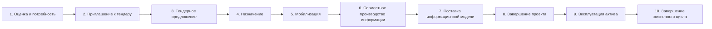
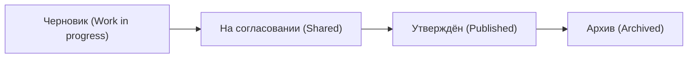

# ISO 19650 — схема этапов (и как это отражено в InfraMap)

**Что это:** международный стандарт управления информацией о построенном активе (BIM), применяется к жизненному циклу объекта — от потребности до эксплуатации.

**Части стандарта ISO 19650:**
- **Ч.1** — Концепции и принципы.
- **Ч.2** — Фаза реализации (проектирование и строительство).
- **Ч.3** — Фаза эксплуатации актива.
- **Ч.4** — Обмен информацией.
- **Ч.5** — Безопасный подход (защита информации).

---

## Схема жизненного цикла (проект → эксплуатация)

- **Фаза реализации** — этапы **1–8** (ISO 19650-2).
- **Фаза эксплуатации** — этапы **9–10** (ISO 19650-3).

---

## Таблица этапов

| № | Этап | English | Что происходит | В InfraMap |
|---|---|---|---|---|
| 1 | Оценка и потребность | Assessment and need | Заказчик формулирует потребность и требования к информации | Карточка объекта, паспорт, категория |
| 2 | Приглашение к тендеру | Invitation to tender | Передача требований участникам | Документ «ПСД/ТЭО», стадия «Планирование» |
| 3 | Тендерное предложение | Tender response | Исполнители предлагают подход и BIM-решения | (этап закупок — goszakup) |
| 4 | Назначение | Appointment | Заключение договора, назначение исполнителей | Поле «Подрядчик», «Договор №», куратор |
| 5 | Мобилизация | Mobilization | Развёртывание процессов и CDE, назначение ролей | Роли и права, «Документы (CDE)» |
| 6 | Совместное производство информации | Collaborative production | Создание и согласование информации | CDE: статусы **Черновик → На согласовании** |
| 7 | Поставка информационной модели | Information model delivery | Передача согласованной информации заказчику | CDE: статус **Утверждён** |
| 8 | Завершение проекта | Project close-out | Итоговый пакет «как построено» | Статус объекта **Завершён**, архив документов |
| 9 | Эксплуатация актива | In use | Техобслуживание, работы, аварии, обращения | Реестр объектов, риски, обращения жителей |
| 10 | Завершение жизненного цикла | End of life | Реконструкция/демонтаж, обновление данных | CDE: статус **Архив** |

---

## CDE — единая среда данных (ядро ISO 19650)

Поток информации по статусам (в InfraMap — модуль «Документы проекта», статусы CDE):

- **Черновик (WIP)** — автор создаёт, видно только команде.
- **На согласовании (Shared)** — проверка и согласование с заказчиком/подрядчиком.
- **Утверждён (Published)** — официальная версия, признана пригодной для использования.
- **Архив (Archived)** — устаревшие/закрытые версии для истории.

---

## Роли по ISO 19650 (кто за что отвечает)

| Роль | Кто в гос-контексте | Функция |
|---|---|---|
| Appointing party (заказчик) | Акимат / управление | Задаёт требования к информации |
| Lead appointed party | Генподрядчик / проектировщик | Ведёт общую информационную модель |
| Appointed parties | Субподрядчики, проектировщики | Создают информацию по своим задачам |
| Information manager | Менеджер информации (проектный офис) | Управляет CDE, версиями, обменом |
| Task team | Рабочие группы | Готовят «контейнеры информации» |

---

## Как это ложится на InfraMap (честно)

- **Реализовано в прототипе:** модуль документов со **статусами CDE**, привязка документов и договоров к объекту, milestones (план/факт), аудит изменений, RFI с контролем срока ответа.
- **Этап пилота:** роли и права по модели ISO 19650, единая среда данных (CDE), контроль версий, обмен информацией (Ч.4), подход к защите информации (Ч.5).
- **Без преувеличений:** ISO 19650 — это стандарт управления информацией; мы используем его **принципы (CDE, версии, роли, этапы)**, а не заявляем пройденную сертификацию.
